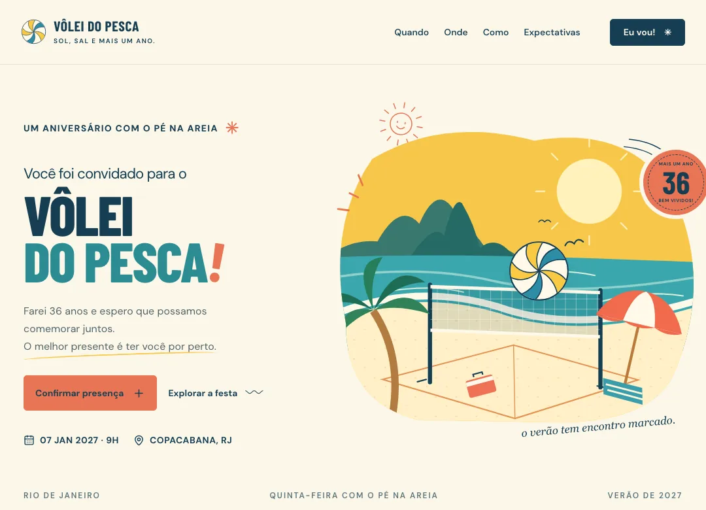
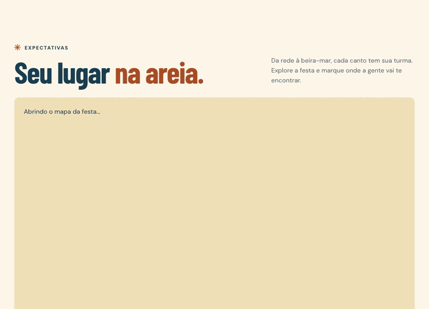
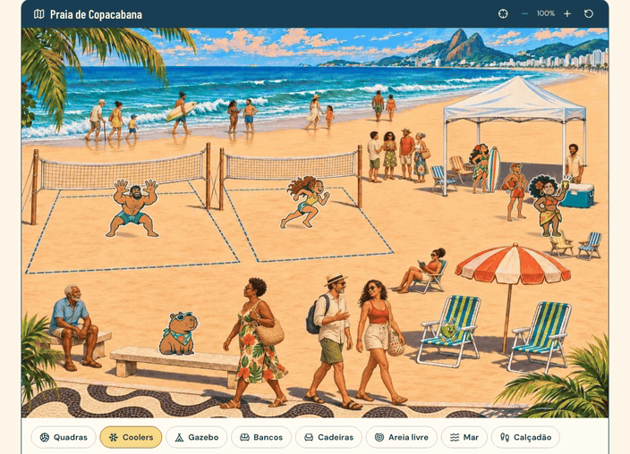
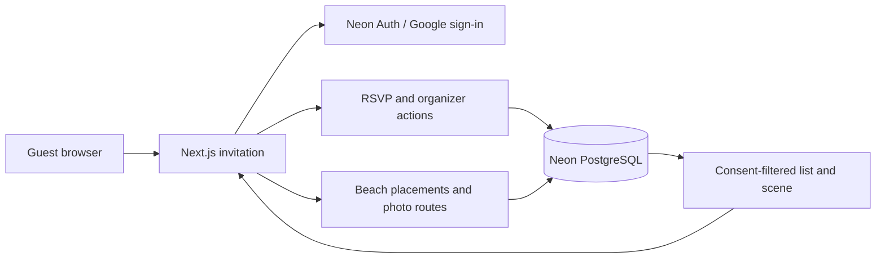

# Vôlei do Pesca — Volleyball Party

**[Open the live invitation](https://volleyball-party.paxeri.dev/)** · [RSVP](#rsvp) · [Stickers Playground](#stickers-playground) · [Run locally](#local-development)

On January 7, 2027, Pesca turns 36 with two volleyball courts on Rio’s Praia de Copacabana. This digital birthday invitation gives guests a way to start spending time together before anyone sets foot on the sand. They can tell the host they’re coming, offer to bring ice, and pick a place where friends will find them on an illustrated beach.



## RSVP

**“Vou”, “Talvez”, “Não vou.”** Guests enter with Google, return to the invitation, and choose their answer. They can edit their name, add up to five companions, choose what to bring, and leave Pesca a private message. Saving **Vou** opens a shortcut to choose their place on the beach.

The answer starts private. Guests can share their first name and sticker, then separately opt into showing their Google picture in the attendance list. Confirmed guests count toward the total even when they keep their name private. Returning with the same account opens their saved answer for editing. Field validation and save feedback let them correct a mistake or retry with their entries still in the form.


[View the saved RSVP](docs/media/rsvp-confirmation.webp)

## Stickers Playground

The signature feature is **Seu lugar na areia**, a shared, illustrated Copacabana. Two volleyball courts face the ocean. Friends can meet in the gazebo shade, gather around the coolers, watch from the benches and beach chairs, or stroll along the mosaic promenade. Anyone can explore the eight areas, open the album, and tap a guest’s sticker to see who’s there.

**Choose a character.** The album has 78 stickers across seven collections. The beach regulars spike, swim, read and dance. Original pop-culture characters share the album with unofficial tributes to volleyball players, anime and games. **Meu personagem** adds 20 personalizable poses. A confirmed guest can upload a photo or use an available Google profile picture, then pan, zoom or rotate it inside the illustrated face.

**Find a place.** Choose an area, tap the map, drag the sticker or use the arrow keys. **Guardar lugar** saves one placement per guest. Returning guests can move it or switch characters. A portrait requires confirmation before placement and follows the guest’s sharing preference. Replacing or removing the photo also removes the placement that used it.



**See who’s coming.** The map reads saved contributions when the page loads. A guest sees their own save immediately. Other visitors see changes when they refresh. Changing attendance away from **Vou** hides the placement while retaining its coordinates for a later confirmation.



[Open the mobile beach](docs/media/mobile-beach.webp) · [Inspect the portrait controls](docs/screenshots/characters/desktop-customization.webp) · [View the populated scene](docs/media/populated.webp)

The demonstrations use Playwright, synthetic accounts, fictional portraits and a disposable local PostgreSQL database. The README features the invitation’s original beach artwork. The tribute inventory records publication decisions for individual images. [Artwork manifest](docs/art/tribute-manifest.json)

## Around the invitation

- Six sections connect the date, location, party plans, RSVP and beach. Wave-shaped dividers, locally served type and Motion animations carry the summer-poster style from desktop to mobile. Navigation supports keyboard use and reduced motion. [Mobile invitation](docs/media/mobile-invitation.webp)
- Guests can download a calendar invitation, open Google Maps and check the weather. The event runs **9 a.m.–5 p.m. in São Paulo time**. The exact meeting point is still to be announced. The weather card labels current conditions until Open-Meteo supplies a complete forecast for the event date.
- The organizer can review replies, export CSV, and hide or restore a guest’s public participation. Organizer access is checked on the server for reads, exports and moderation. [Organizer guide (Português)](docs/RSVP.md)

## How it works



| Part | Implementation |
| --- | --- |
| Invitation | Next.js 16 App Router, React 19 and TypeScript. Server Components load the invitation. Client Components handle forms, Motion animations and map gestures. |
| Visual design | Tailwind CSS 4 and custom CSS, Lucide icons, original SVG illustrations, Barlow Condensed and DM Sans from Fontsource. |
| Identity and persistence | The Neon Auth SDK verifies the Google-backed session. Server Actions validate inputs with Zod and use parameterized SQL through `pg`. PostgreSQL functions check eligibility, ownership, consent and organizer access. |
| Artwork and portraits | Responsive WebP maps, a foreground atlas, individual sticker files and SVG face masks. Sharp checks and re-encodes uploads as WebP, strips metadata and limits the longest side to 512 px. Portrait bytes live in PostgreSQL and are served through a visibility-checked route with private, no-store caching. |
| Hosting | Netlify runs the Next.js application. The weather route queries Open-Meteo. The map embed and directions link use Google Maps. |

### Engineering the beach

- **One place across screen sizes.** The editor converts a touch or pointer position into fractions of the 1536 × 1024 painting. Each pose has a ground contact, such as feet, a chair base or a waterline. Existing stored centers still convert to the same ground point after a resize or zoom. [Placement geometry](lib/beach.ts)
- **Depth from a flat painting.** Scale changes between depth lines measured across the scene. Transparent pieces of the original nets, seats and coolers draw in front of guests standing behind them. A separate control lets guests grab a sticker even when part of it is obscured. [Perspective and artwork guide (Português)](docs/art/perspectiva.md)
- **A map that works under a thumb.** On narrow screens the whole beach fits initially. Choosing an area zooms in. A drag starting on the guest’s sticker captures the pointer, while the surrounding map supports panning. Nearby free spots can snap into place. Zone buttons and keyboard nudges offer precise alternatives. [Playground guide (Português)](docs/PRAIA.md)
- **One portrait, twenty poses.** The editor and map use the same face mask and framing calculation. The server derives ownership from the guest’s session, and the database links the photo and placement to that same owner. [Character guide (Português)](docs/PERSONAGENS.md)

## Local development

Use Node.js 22 LTS (tested with 22.23.3) and npm. From the repository root, start with a fresh local environment.

```sh
npm ci
cp .env.example .env.local
npm run dev
```

Open [localhost:3000](http://localhost:3000). With the database and auth values blank, you can browse the full invitation, explore the map and try the sticker album. The RSVP section explains that confirmations are unavailable. For an end-to-end run with synthetic guests and no cloud account, use `npm run test:e2e:rsvp` as described below.

### Guest accounts and database

1. Use a development Neon branch with PostgreSQL and Managed Better Auth. Enable Google sign-in. Set the invitation origin as a trusted domain. When using your own Google OAuth client, register **Neon’s provider callback** in Google Cloud and store the Google credentials in Neon. The app’s `/auth/callback` completes the return to the invitation. [Neon OAuth setup](https://neon.com/docs/auth/guides/setup-oauth)
2. On a fresh development database, connect directly as the owner in `psql` and create the runtime login. The migrations install `pgcrypto`, create the `pesca` schema and grant the runtime role access to the application functions.

   ```sql
   CREATE ROLE pesca_runtime LOGIN;
   \password pesca_runtime
   SELECT format('GRANT CONNECT ON DATABASE %I TO pesca_runtime', current_database()) \gexec
   ```

3. Export `DEV_ADMIN_DATABASE_URL` in your shell using that **direct development owner connection**, then run `npm run db:migrate:dev`. A fresh install creates invitation settings with an optional invite code disabled. Guest records are created through RSVP. No guest seed is required.
4. Fill in the server environment in `.env.local`, restart the dev server, and open the exact origin in `SITE_URL`. [Environment template](.env.example)

| Variable | Local value or purpose |
| --- | --- |
| `SITE_URL` | `http://localhost:3000`. Used for sharing metadata, OAuth return URLs and photo origin checks. |
| `DATABASE_URL` | Pooled connection for `pesca_runtime` on the chosen Neon branch. Use a URL-encoded password and `sslmode=verify-full`. |
| `NEON_AUTH_BASE_URL` | Full Managed Better Auth URL for the same branch, including its path. |
| `NEON_AUTH_COOKIE_SECRET` | Stable server secret. Generate one with `openssl rand -base64 32`. |

Event details live in `lib/event.ts`. The section components are in `components/sections/`, the interactive beach in `components/beach/`, and the request handlers in `app/actions/` and `app/api/`. [Event configuration](lib/event.ts)

## Testing

| Command | What it verifies |
| --- | --- |
| `npm run typecheck` | Generates Next.js route types and checks TypeScript. |
| `npm test` | Node test runner with `tsx`. Calendar, weather, RSVP, CSV, scene geometry, asset inventory, portrait processing and publication restrictions. |
| `npm run test:db` | Applies and replays migrations in a fresh PostgreSQL cluster, then checks visibility, grants, authorized writes and placement compatibility. |
| `npm run test:e2e` | Desktop and mobile Chromium journeys through navigation, calendar, weather states, responsive layout and the invitation without credentials. |
| `npm run test:e2e:rsvp` | The actual auth SDK and a local identity fixture, backed by another disposable PostgreSQL cluster. Covers RSVP edits, private and shared placements, touch, keyboard, portrait withdrawal, moderation and error recovery. |
| `npm run build` | Optimized Next.js build. Use `npm start` to serve it locally. |

Install the browser once with `npx playwright install chromium`. For the database-backed suites put `initdb`, `pg_ctl` and `psql` on your `PATH`, with `pgcrypto` available. Run as a regular user. The harness creates a temporary cluster, passes a socket URL to the app and shuts the cluster down afterward. The two browser configurations isolate the credential-free landing server from the authenticated fixture. To exercise the optimized server, build first and run `PLAYWRIGHT_RSVP_PRODUCTION=1 npm run test:e2e:rsvp`.

## Migrations and deployment

The numbered SQL files in `db/` are the migration history. Append the next numbered file when the schema changes. The runner takes a transaction lock, checks the target database and records SHA-256 checksums. Replaying an up-to-date database leaves existing responses and placements in place. A pre-history installation needs a schema and initialization-data comparison against a clean database before using `--baseline NNN_name.sql`. [Migration runner](scripts/migrate.mjs)

For Netlify, build from the repository root with `npm run build`, use the Next.js output in `.next`, and supply the four application variables above to the build and server runtime. Set `SITE_URL` to the custom HTTPS origin and register that origin in Neon Auth. Netlify’s Next.js adapter serves the dynamic routes and Server Actions. The repository leaves site-specific hosting settings in Netlify. [Netlify’s Next.js guide](https://docs.netlify.com/build/frameworks/framework-setup-guides/nextjs/overview/)

When a release needs new SQL, validate it in development first. An operator applies `npm run db:migrate:production` using `ADMIN_DATABASE_URL` from an administrative shell or ignored `.env.admin` file before deploying the dependent code. Keep this direct owner connection separate from the Netlify runtime role. The application build runs independently of migrations. [Hosted verification guide (Português)](docs/RSVP.md#verificação-no-ambiente-hospedado)

**Live invitation** · [Custom domain](https://volleyball-party.paxeri.dev/) · [Original Netlify address](https://volleyball-party.netlify.app/)
