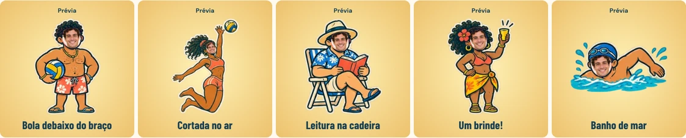

# Meu personagem

Em **Expectativas → Escolher figurinha → Meu personagem**, um convidado que confirmou **Vou** pode montar uma figurinha com o próprio rosto. Quem visita o convite também pode experimentar as 20 poses com um rosto ilustrado. O mapa mantém um lugar por convidado. Trocar a pose permite usar a mesma foto novamente.

| Tela | Desktop | Celular |
| --- | --- | --- |
| Escolha da pose e da origem da foto | [Álbum](screenshots/characters/desktop-selector.webp) | [Álbum](screenshots/characters/mobile-selector.webp) |
| Foto aplicada, prévias e ajustes | [Personalização](screenshots/characters/desktop-customization.webp) | [Personalização](screenshots/characters/mobile-customization.webp) |
| Dois convidados em profundidades diferentes junto às figurinhas comuns | [Praia](screenshots/characters/desktop-shared-beach.webp) | [Praia](screenshots/characters/mobile-shared-beach.webp) |

## Foto e consentimento

O servidor reconhece o convidado pelo identificador de sua sessão Neon Auth. **Usar minha foto de perfil** importa a imagem que o Google já disponibilizou nessa sessão. A importação parte de uma ação voluntária e dispensa uma nova conexão OAuth. A aplicação não consulta o e-mail do convidado. **Enviar uma foto** aceita JPEG, PNG ou WebP e funciona mesmo quando o provedor não fornece uma imagem.

O servidor limita a leitura a 5 MB, confere o formato decodificado e aceita uma única imagem estática entre 48 px no menor lado e 8.192 px no maior, com até 16 megapixels. Sharp orienta a imagem, preserva sua proporção e grava um WebP de até 512 px por lado, sem os metadados de origem. A busca remota usa a URL HTTPS do perfil verificado, valida o host do Google e recusa redirecionamentos. Uma falha de importação orienta o convidado a enviar uma foto.

A primeira cópia é privada. Depois de escolher **Adicionar ao cenário**, o convidado posiciona a figurinha, marca a confirmação de visibilidade e seleciona **Guardar lugar**. A preferência de primeiro nome do RSVP continua valendo. Com a lista privada, só o dono vê o personagem. Alterações de presença, visibilidade ou moderação também valem para os pedidos à URL da imagem.

**Remover minha foto** apaga a cópia do banco da aplicação e, na mesma transação, a figurinha que a usa. **Alterar foto** troca a cópia privada, invalida a URL anterior e exige nova colocação e confirmação. A preferência da lista de presença é independente. A rota entrega a imagem com `Cache-Control: private, no-store`. Uma página já aberta pode exibir os pixels que recebeu até ser atualizada. Backups históricos seguem a retenção configurada na hospedagem do banco.

## Arte e composição

Os 20 WebP transparentes de 256 × 256 px somam aproximadamente 429 KiB. Cada desenho inclui cabelo, orelhas, roupa e acessórios em primeiro plano. O contorno individual da abertura da testa ao queixo segue a linha do desenho. Um SVG usa essa máscara para enquadrar a fotografia e desenha o corpo sobre ela. O rosto ilustrado serve de prévia e de alternativa caso a foto fique indisponível.

O registro contém o arquivo de cada pose por convenção de nome, o centro e tamanho normalizados da cabeça, a rotação, o contorno em coordenadas da arte, o apoio no chão, a área de toque, a zona sugerida e a referência de perspectiva. A posição e o zoom da foto usam o espaço disponível dentro da imagem, inclusive quando o convidado gira um retrato retangular. O editor e a cena usam o mesmo componente em todas as escalas. [Registro](../lib/character-art.json) · [Composição](../components/beach/sticker-art.tsx) · [Arquivos das poses](../public/beach/characters/)

As poses incluem saque, cortada, bloqueio, recepção, preparação, comemoração e bola debaixo do braço. Há também nado, mergulho, futebol, protetor solar, caminhada, fotografia, brinde, água de coco, milho, leitura na cadeira, descanso no gazebo, cooler e dança. A pessoa escolhe livremente a ilustração. O sistema aplica o enquadramento escolhido e não analisa características faciais.

Para acrescentar uma pose, exporte o WebP com a abertura transparente, acrescente a geometria, o nome, a zona e a referência ao registro e libere o novo identificador em uma migração. O arraste, as setas, os atalhos de área, a profundidade, as sombras e a oclusão usam o editor da praia.

## Banco e publicação

A migração 005 cria `pesca.character_photos` e estende `sticker_placements` com uma referência de foto e o enquadramento. A chave estrangeira composta vincula a foto ao próprio dono. O identificador público é aleatório. A leitura pública retorna primeiro nome e composição e verifica o RSVP ao servir os bytes. O servidor e o banco validam a pose e os limites dos controles. O endpoint antigo continua lendo as figurinhas convencionais durante a atualização do aplicativo. [Migração](../db/005_personal_characters.sql)

O ambiente usa as mesmas quatro variáveis do convite, a origem exata de `SITE_URL` e o callback Google já registrado no Neon. O processamento da imagem exige o runtime Node.js com o pacote Sharp da plataforma. O PostgreSQL armazena a imagem. A hospedagem precisa encaminhar o corpo do upload e a resposta privada sem cache. O fluxo não requer bucket, chave de IA ou mudança de escopo OAuth.

Use `npm run db:migrate:dev` na branch de desenvolvimento e `npm run db:migrate:production` para o destino de produção. O executor verifica o destino e o histórico dentro de uma transação. O álbum faz parte da página principal servida por `npm run dev` e pela combinação `npm run build` e `npm start`. [Configuração e publicação](../README.md#migrations-and-deployment)

## Verificação

Os testes unitários exercitam as aberturas, o enquadramento, as coordenadas de chão, os tipos de arquivo e as falhas de importação. Os testes SQL usam PostgreSQL real para verificar consentimento, propriedade, mudanças de imagem, visibilidade e compatibilidade com figurinhas anteriores. No Playwright, duas sessões independentes passam pelo login simulado, escolhem retratos fictícios, guardam os personagens e verificam a retirada da foto em outra sessão. O teste de imagem do Google usa uma resposta simulada. O acesso a uma conta Google real depende da autorização de seu titular.

As capturas desta página foram feitas no próprio convite em Chromium desktop e com emulação de iPhone 13. Os retratos de teste ficam fora dos arquivos públicos. [Testes de navegador](../tests/e2e-rsvp/characters.spec.ts) · [Retratos fictícios](../tests/fixtures/portraits/)

Direção de arte e prompts de geração

A ferramenta ImageGen integrada produziu as folhas de arte reutilizáveis e os dois retratos fictícios. A coleção original de Copacabana serviu de referência para as cores, a borda creme e os contornos. Nenhuma foto de convidado participa desse processo.

- **Folha principal.** “One transparent production sprite atlas, exactly FOUR columns and FIVE rows on a 4:5 canvas, 20 evenly spaced complete isolated die-cut cartoon beach characters.” A especificação pediu contornos petróleo, coral, turquesa, açafrão e cobalto, diversidade de corpos, cabeças ligeiramente grandes, rostos frontais em magenta uniforme e cabelos, orelhas, chapéus e pescoços ilustrados. As linhas reuniram respectivamente bola/cortada/cadeira/brinde, nado/saque/bloqueio/recepção, ponto/preparação/mergulho/futebol, protetor/caminhada/foto/coco e milho/gazebo/cooler/dança.
- **Revisão de silhuetas.** “Full figure from hair to bare FEET with margin in each square cell.” Uma folha 3 × 2 refez bloqueio, protetor, fotografia, bebida, milho e comemoração, com os objetos abaixo do rosto e os pés inteiros.
- **Revisão de movimentos.** “Each figure entirely contained and centered in its own square cell, roomy transparent margins on ALL sides.” Uma folha 3 × 2 refez saque, preparação, futebol, mergulho e cortada e explorou uma segunda cadeira. A seleção final preserva a cadeira da primeira folha.
- **Fotografias de teste.** “A photographic contact sheet of two entirely fictional adult beach party guests for testing a portrait crop interface.” O díptico pediu retratos frontais centralizados, um adulto de cachos castanhos e outro de cabelo prateado, com iluminação natural e fundo creme.

